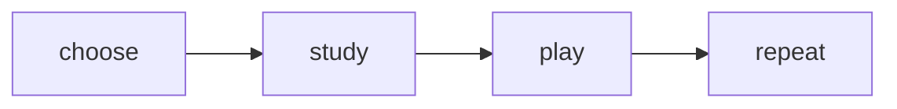

# Web Docs Client

## Responsibility and files

`@kartuli/web-docs-client` renders the `@kartuli/docs` workspace with VitePress. Markdown is in `docs/`; site config is `tools/web-docs-client/.vitepress/config.mts`; scripts are in `scripts/` beneath the tool. Static assets come from the tool's absolute public directory. The site base is `/kartuli/` in both local and hosted use.

## Choose the command

Run these from the repository root:

| Command | What it does | Expected result |
| --- | --- | --- |
| `pnpm run c:dev:web-docs-client` | Generates source/public LLM index, then starts VitePress dev | Live Markdown editing; use the URL/port printed by VitePress, with `/kartuli/` |
| `pnpm run c:build:web-docs-client` | Turbo target build; on a miss validates source/navigation, builds the site and checks the dist index | Static files in `tools/web-docs-client/.vitepress/dist` |
| `pnpm run c:preview:web-docs-client` | Runs the workspace preview script: build first, then VitePress preview | Built site, normally `http://localhost:4173/kartuli/` |
| `pnpm --filter @kartuli/web-docs-client exec vitepress preview` | Serves existing dist only | Useful after a known successful build; does not regenerate anything |
| `pnpm --filter @kartuli/web-docs-client run generate-llm-bundle` | Scans current Markdown and writes source/public index | Fresh index without building the site |
| `pnpm --filter @kartuli/web-docs-client run check-docs` | Checks descriptions, local file links and index coverage/copies | Requires generation first |
| `pnpm --filter @kartuli/web-docs-client run check-docs -- --built` | Also compares dist index with source | Requires a completed fresh build |
| `pnpm --filter @kartuli/web-docs-client run test` | Generates/checks the index and tests navigation contracts | No browser dependency |

The package's `preview` script already builds. A failed build prevents preview from starting; check the terminal rather than assuming an older browser tab represents the new build.

The Web Docs build runs the workspace test first: index generation, `check-docs` and Node navigation
tests. After rendering/copying, it checks the built index too. Local `validate:all` runs that workspace
test through Turbo; its cache inputs include `docs/**`. The all-monorepo PR action runs it explicitly,
because root Vitest coverage does not discover the Node suite. PR preview and production builds
therefore enforce the documentation contract as well.

## LLM index lifecycle and URLs

`generate-llm-bundle.js` writes identical generated content to `docs/kartuli-llm.txt` and `tools/web-docs-client/public/assets/kartuli-llm.txt`. Both are ignored by Git. The public copy makes the text available in dev and part of the static build; `copy-llm-bundle.js` also writes the final dist asset after a successful build.

At preview's usual port, open `http://localhost:4173/kartuli/assets/kartuli-llm.txt`. In dev use the printed dev port with the same path. On Pages the published URL is `https://kartuli-app.github.io/kartuli/assets/kartuli-llm.txt`. The navigation opens the current host's text asset outside the client-side page router; it should show plain text, not a docs page/404.

The file is a **links-only index**. Its entries intentionally use canonical published URLs, even when the index itself is opened locally. They do not certify those new pages have already been deployed. To inspect an unmerged page locally, follow the local site's navigation or substitute the local origin while retaining `/kartuli/`.

Generation happens when dev starts; editing Markdown does not continuously regenerate the text index. Rerun generation after content edits before checking it. A Turbo build cache hit restores dist but may not restore the source/public intermediates. Force a fresh target build or regenerate when comparing all copies.

## Navigation and authoring

Testing uses `docs/06-quality/01-testing/index.md` as its clickable overview, with all four guides
in the same folder. Navigation follows the same folder-hub rule as every other area.

`scripts/docs-processor.js` collects numbered folders/files and descriptions; H1 headings supply human labels. `site-navigation.js` turns `index.md` into its folder's clickable heading and removes duplicate hub children. A hub-only section is a link, not an expandable group containing “Index”. One shared sidebar exposes all top-level sections on the home page and every documentation page. Sections with children are collapsible; hub-only sections are direct links. The top navbar links directly to each section overview, without a Documentation wrapper menu.

Restart dev after adding/renaming pages or changing H1 labels so the configuration rescans navigation. Keep existing URLs stable. Templates live outside `docs/`, under `documentation-templates/`, and are neither published nor indexed. Add a nonempty description and visible implementation status to each page. See [Writing Guide](../12-project/01-documentation/01-writing-guide.md).

## Troubleshooting

| Symptom | Inspect / next action |
| --- | --- |
| Local index 404 | Confirm port and `/kartuli/assets/` path; run generation for dev or complete the preview build |
| Index opens the live site | Distinguish the local text file from its canonical published page links; use local navigation for branch content |
| Text response is HTML | Check actual response URL and stale server/SPA routing; use the direct asset URL |
| Index omits a page | Check `.md` extension, description, H1, generation time and any `llm: skip` marker |
| Build stops before copy | Read the first build error; no new dist index is guaranteed |
| Stale result after cache hit | Regenerate intermediates or force `pnpm turbo run build --filter=@kartuli/web-docs-client --force` |
| Mermaid stays in a loading state | Check browser console errors and confirm `mermaid` and `@aether-labs/vitepress-mermaid` resolve from the Web Docs workspace |
| Mermaid shows a render error | Check the fence syntax with the installed Mermaid version; the error state retains the source for diagnosis |

## Mermaid authoring and verification

Web Docs renders standard `mermaid` fences in the browser through
`@aether-labs/vitepress-mermaid` and the installed `mermaid` package:

````md

````

No external rendering service, generated SVG cache or manual renderer command is involved. VitePress
dev hot updates use the same integration, so editing a fence does not require deleting cached assets
or restarting for diagram output. The integration observes VitePress's light/dark state and rerenders
Mermaid with the matching theme. Kartuli sets Mermaid's security level to `strict` and otherwise uses
the integration's theme behavior. The renderer is registered explicitly through the package's
VitePress theme wrapper so production and development use the same component. Because VitePress uses
the shared `docs/` directory as its Vite root, the app also resolves and prebundles its direct Mermaid
entry from the Web Docs workspace explicitly. This keeps Mermaid's runtime dependency graph compatible
with the Vite development server.

A successful build proves that the source compiled, not that client-side Mermaid initialized. Run the
production preview and the Web Docs E2E suite, then inspect the Product Overview diagram. The browser
test requires a visible SVG containing the expected learning-loop labels, rejects raw fenced source,
loading and error states, and switches the VitePress appearance once to exercise both themes.

This affects rendering only: authors or coding agents still write Mermaid source. The
dependency-cruiser/Graphviz [Diagram Generator](./04-diagram-generator.md) remains a separate pipeline.

Before review: generate and check docs; run navigation tests, the full docs build, the built-index check and `pnpm run validate:all`. Inspect the section menus, hub links and text asset on desktop and narrow screens. `check-docs` checks file targets, not remote endpoints, every fragment anchor or visual layout. Record any blocked gate explicitly.

## End-to-end documentation check

The following sequence exercises source generation, static rendering, built-copy equality and browser
delivery without relying on an older dev server:

```bash
pnpm --filter @kartuli/web-docs-client run generate-llm-bundle
pnpm --filter @kartuli/web-docs-client run check-docs
pnpm run c:build:web-docs-client
pnpm --filter @kartuli/web-docs-client run check-docs -- --built
pnpm --filter @kartuli/web-docs-client exec vitepress preview
```

With preview running, verify from another terminal:

```bash
curl -fsS http://localhost:4173/kartuli/ >/dev/null
curl -fsS http://localhost:4173/kartuli/assets/kartuli-llm.txt | sed -n '1,20p'
pnpm e2e web-docs-client --url http://localhost:4173/kartuli
```

Expected results are a rendered home page, a plain-text index headed `# kartuli-llm.txt`, a visible
Product Overview Mermaid SVG in both themes, passing navigation/index smoke tests and no critical
browser console errors. Inspect the visible sidebar at wide and narrow widths as well: automated link
checks do not prove that navigation is readable or reachable at every viewport.
